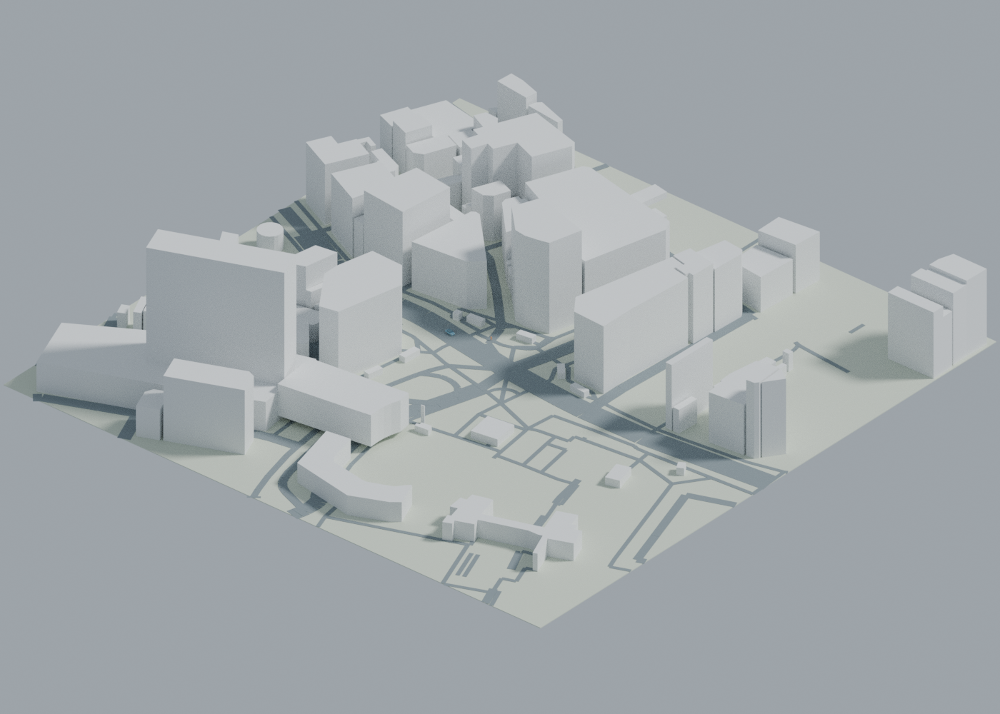

# Whitebox World · 可编辑环境白模

城市、海滩、森林、草原的 Blender 原生白模生成器。生成可独立编辑的地形、建筑、树木、行人、车辆和路径，并支持逐角色速度、日照、天气外观、动画与数据导出。



默认真实城市示例：[渋谷 300m 街区与新增城市说明](docs/REAL_CITY_DATA.md)。数据来自与 Rokehan 相同的公开 OSM 数据包。© OpenStreetMap contributors，ODbL 1.0；地形仍为平地。

## 立即打开

- `artifacts/shibuya.blend`：真实渋谷建筑/道路、人车动画；附 `.glb`、`.png` 和 `.poses.json`。
- `configs/shibuya.geojson` / `shibuya.json`：可离线重建的真实地图及路径配置。
- `artifacts/mixed.blend`：城市 + 海岸混合场景，含已烘焙的人车动画。无需插件即可播放时间轴、编辑网格。
- `artifacts/mixed.glb`：可导入其他 DCC/引擎的网格与烘焙动画。
- `artifacts/mixed.poses.json`：逐帧位置、朝向与速度，单位米、秒，Z 轴向上。
- `artifacts/whitebox_world_addon.zip`：Blender 插件安装包。
- `configs/`：五种场景以及地图导入示例。

开发与验证环境：Blender 4.3.2 / Python 3。插件声明 Blender 4.2+，其他版本尚未逐一测试。无需额外 pip 依赖。

## 安装与交互

1. Blender → Edit → Preferences → Add-ons → 右上角菜单 → Install from Disk，选 `whitebox_world_addon.zip` 并启用。
2. 3D Viewport 按 N，打开 **Whitebox** 标签。
3. 选择 Biome、Seed 和 Size，点 **Generate / Replace Whitebox**。
4. 在 Outliner 的 `WW_Actors` 集合选中行人或车辆的根 Empty；面板出现 Speed (m/s)、Start offset (m)、Loop 和 Path object。
5. 调整速度后改变帧数或点 Refresh Actor Pose。各角色独立，镜头移动不影响模拟时钟。
6. 选择 `WW_Paths` 下角色路径，Tab 进编辑模式移动折线控制点。路径是可编辑 POLY 曲线。
7. 调整 Sun elevation / Sun azimuth / Weather，点 Apply Sun / Weather。
8. 保存前点 Bake Actor Animation；导出 GLB 会自动烘焙当前帧范围。

生成只替换 `WW_` 前缀的集合，其他内容保留；请不要把需要保留的自有资产放进该命名空间。重新生成会覆盖白模内的手动修改，先另存文件。

## 命令行生成

在项目根目录执行（macOS/Windows 请替换 blender 为实际可执行文件）：

```sh
blender -b --python scripts/build_scene.py -- --config configs/mixed.json --output artifacts/mixed.blend --render --glb --poses
blender -b --python scripts/build_scene.py -- --config configs/forest.json --output artifacts/forest.blend --render
blender -b --python scripts/build_scene.py -- --config configs/imported_city.json --output artifacts/imported_city.blend --render
```

`--quick` 降低渲染分辨率和采样。离线内置场景不访问网络；种子使自然分布可复现。场景尺寸单位米。普通默认场景为 120–160m 街区，不建议未经分块直接导入整座城市。

## 配置示例

```json
{
  "biome": "forest", "size": 120, "seed": 42,
  "fps": 24, "duration": 12,
  "sun_elevation": 35, "sun_azimuth": 135, "weather": "clear",
  "actors": [
    {"name": "Walker", "kind": "person", "speed": 1.4,
     "offset": 0, "loop": false,
     "path": [[-40, -8, 0], [20, -8, 0], [20, 20, 0]]},
    {"name": "Car", "kind": "vehicle", "speed": 8,
     "path": [[-50, -3, 0], [50, -3, 0]]}
  ]
}
```

biome：`city / beach / forest / grassland / mixed`。weather：`clear / overcast / fog / rain`。
速度是沿路径弧长的米/秒；`offset` 是起点距离，`loop=false` 到终点停住，`loop=true` 到终点跳回起点。希望闭环运动时，请把路径最后一点设为第一点；转角为即时朝向变化，尚无平滑转向或避障。修改总时长可直接改 Blender 的时间轴范围。

## 地图数据

接受 `.geojson` 和 OSM `.osm/.xml`。建筑 footprint 挤出高度，道路沿中心线生成条带。支持 WGS84 投影到局部米制坐标；本地数据请明确 `coordinate_system: "local"`，避免小数值局部坐标被误认为经纬度。

```json
{"biome":"city", "size":160, "map_file":"demo_city.geojson", "coordinate_system":"local"}
```

`map_file` 在 CLI 中相对配置文件目录解析。UI 中使用文件浏览器选择完整路径。内置 `demo_city.geojson` 是原创合成数据，不是真实地点。真实渋谷已内置，新增城市可先用 `scripts/fetch_rokehan.py --lat ... --lon ... --size 300 --output configs/my_city.geojson`，详见 [真实城市说明](docs/REAL_CITY_DATA.md)。也可自行下载 OSM 后导入；另一个可选下载器：

```sh
python scripts/fetch_osm.py --help
```

真实 OSM 数据需保留 `© OpenStreetMap contributors` 与 ODbL 归属；场景保存地图来源元数据。缺失建筑高度会估算；具体解析警告保存在 scene 的 `ww_map_warnings`。当前无 DEM 地形、复杂屋顶、建筑内洞/庭院、关系型 multipolygon 全量复原、道路交叉口拓扑或在线地图点选器。

## 资产替换

角色是 Empty 根对象和独立网格子对象。保留根对象、`ww_actor / ww_path_name / ww_speed` 等属性，将自己的网格或绑定资产 parent 到根对象，再隐藏/删除默认网格。根节点沿路径移动；自定义骨骼步行动画由用户自行提供。默认行人是摆臂摆腿的几何代理，不是逼真人体、姿态估计骨架或动捕动画。车辆轮子是独立对象，默认按位移转动。

## 天气与导出边界

- 晴天/阴天：太阳强度、光照柔和度和世界光变化；日照角度可控。
- 雾：Blender 体积材质；雨：确定性几何雨丝的静态视觉预览，尚无雨滴粒子动力学或湿地反射系统。
- `.blend` 保留网格、父子层级、路径、相机、光照和烘焙关键帧；实时控制需要安装插件。没有插件时，仍可播放烘焙动画。
- GLB 导出网格、层级和采样动画；体积雾与 Blender 世界光不会按原样传到 glTF。不同查看器对相机/灯光支持不同。
- 这是独立编写的 Blender-first v0.1，不是 Rokehan 网站的源码复制或全部 Web 功能复刻。功能思路受 [Rokehan](https://tools.oyasumi-gamedev.com/rokehan/) 的地图白模流程启发；未发现应用源码明确再发布授权，因此未使用其代码或素材。

## 测试

```sh
python -m unittest discover -s tests -p 'test_*.py' -v
blender -b --python tests/blender_integration.py
```

集成测试覆盖：五种环境、独立角色速度、改变相机不影响运动、烘焙后改速、路径编辑、四类天气、插件注册/注销、用户对象保留、GLB 实际回读动画和逐帧 JSON。

源码 MIT 授权。该许可不替代用户导入地图与资产的各自许可。

## 数据许可

代码为 MIT；`configs/shibuya.geojson` 的 OSM 地图数据为 ODbL 1.0，详见 [真实地图来源与限制](docs/REAL_CITY_DATA.md)。渋谷图片和模型：© OpenStreetMap contributors，数据包由 Rokehan 提供。
